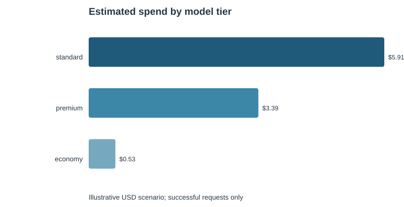
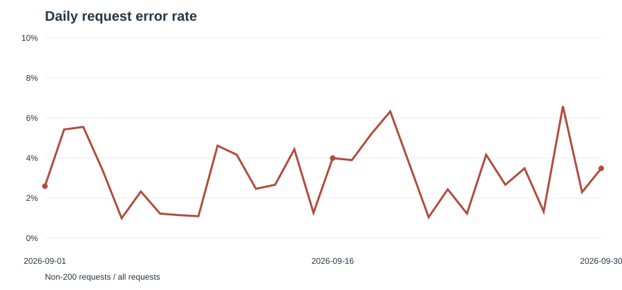

# LLM Usage Analytics

An end-to-end analytics demonstration for reviewing model usage, estimated token spend, and request failures. The project creates a **fully synthetic** request log, loads it into SQLite, runs documented SQL analyses, and exports tables and charts for a short operational review.

## Business question

How is API usage distributed across teams and model tiers, what would that usage cost under a stated pricing scenario, and where are request failures concentrated?

## Important scope

- The request log is generated locally with a fixed random seed. It contains no customer data, credentials, or live API traffic.
- Model names and USD-per-million-token rates in `config/model_scenarios.csv` are illustrative scenario inputs, not current provider prices or a quote.
- Estimated cost includes successful requests only. Failed requests are counted in reliability metrics and assigned zero cost in this demonstration.
- Findings describe this synthetic sample only. They do not establish production behavior or prove that a recommended action will cause savings.

## Run it

Use Python 3.10 or newer. The analysis script uses only the Python standard library and SQLite.

```bash
python src/run_analysis.py
```

The script writes the reproducible raw JSONL file to `data/` and analysis outputs to `reports/`. Re-running it with the same code produces the same sample. To run the optional notebook walkthrough, install its display dependencies with `python -m pip install -r requirements.txt` and open `notebooks/llm_usage_analytics.ipynb`.

## What the analysis does

1. Generates 2,500 synthetic requests across four teams and three model tiers over 30 days.
2. Checks request IDs, timestamps, status codes, and token counts before analysis.
3. Loads requests and scenario assumptions into an in-memory SQLite database.
4. Uses SQL CTEs and window functions to calculate spend by team and model, share of model spend, daily success/error rates, average latency, and failure rankings.
5. Exports reviewable CSV tables, a data-quality summary, two charts, and a short findings note.

## Example outputs

See the [sample findings](reports/findings.md) for the exact results and limitations of the generated run.





## Project files

- `src/run_analysis.py` - reproducible data generation, validation, SQL execution, and report creation
- `sql/` - the analytical queries used by the script
- `config/model_scenarios.csv` - editable illustrative rate assumptions
- `data/sample_api_requests.jsonl` - generated synthetic input
- `reports/` - generated CSVs, SVG charts, QA summary, and findings
- `notebooks/llm_usage_analytics.ipynb` - short walkthrough of the generated outputs

## Metric definitions

- **Estimated spend:** successful prompt and completion tokens multiplied by the selected scenario rates, divided by one million.
- **Error rate:** requests with a non-200 status divided by all requests in the period.
- **429 rate:** requests with status 429 divided by all requests in the period.
- **Model spend share:** a team's estimated spend divided by total estimated spend for that model tier.

## Interview summary

> Built a reproducible Python and SQLite analytics workflow on 2,500 synthetic LLM requests; used SQL window functions to summarize scenario-based spend and rank reliability issues, then exported QA checks, CSV reports, and charts.

## Limitations and next steps

This is a portfolio demonstration, not a live monitoring service. It does not call model APIs, store secrets, stream events, or model retries and partial billing. To adapt the workflow to real data, replace the generator with an approved export, confirm provider billing rules and current rates, and validate metric definitions with the data owner.

## Additional portfolio project

- [E-commerce Customer Retention & Revenue Analytics](ecommerce-retention-analytics/README.md) - synthetic-data practice project using Python, SQLite, cohort retention, monthly performance, channel comparison, and RFM segmentation.

