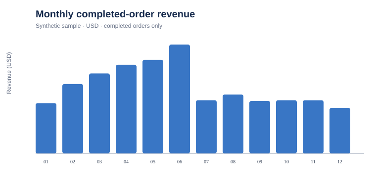
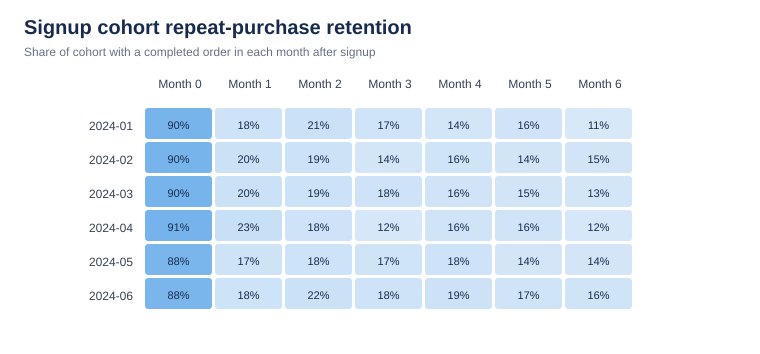

# E-commerce Customer Retention & Revenue Analytics

A beginner-friendly portfolio project that explores customer repeat purchasing, monthly revenue, acquisition channels, and signup-cohort retention with Python and SQLite. All records are deterministic synthetic data; the results are for practice and are not claims about a real business.

## Questions this project answers

- How much completed-order revenue and how many orders occur each month?
- What share of customers purchase again?
- How does repeat purchasing differ by acquisition channel?
- How many customers from each signup cohort return in later months?
- Which customers appear most valuable by a simple recency, frequency, and monetary (RFM) view?

## Tools

- Python 3.10+ standard library
- SQLite and SQL (including CTEs and window functions)
- CSV and simple SVG charts

## Run

From this folder:

```bash
python src/run_analysis.py
```

The script generates the synthetic input CSVs in `data/`, builds a temporary SQLite database, executes the SQL in `sql/`, and writes tables and charts to `reports/`. The fixed random seed makes the generated sample reproducible.

## Data and definitions

- `customers.csv`: synthetic customer ID, signup date, acquisition channel, and region.
- `orders.csv`: synthetic order ID, customer ID, order date, order amount, category, and status.
- Revenue and order counts include completed orders only. Cancelled and refunded orders are excluded from completed-order revenue.
- Repeat customer rate = customers with at least two completed orders / customers with at least one completed order.
- Cohort month 0 is the signup month. Retention is the share of a cohort with a completed order in each month after signup.
- RFM uses recency in days from the last completed order to the analysis cutoff, completed-order count, and completed-order revenue. It is a descriptive segmentation, not a prediction.

## Outputs

- `reports/executive_kpis.csv`
- `reports/monthly_performance.csv`
- `reports/channel_performance.csv`
- `reports/cohort_retention.csv`
- `reports/rfm_customers.csv`
- `reports/summary.md`
- `reports/monthly_revenue.svg`
- `reports/cohort_retention.svg`

## Interview summary

> Analyzed deterministic synthetic e-commerce orders with Python and SQLite; defined repeat-purchase and cohort-retention metrics, used SQL CTEs and window functions to segment customers, and generated reproducible CSV and chart outputs.





## Limitations

This is a skills demonstration using generated data, not a forecast, causal analysis, or real-company case study. The generated sample has intentionally simple purchasing behavior and should not be used to infer actual customer behavior. A real analysis would require agreed metric definitions, privacy-approved data, data-quality checks, and business context.

